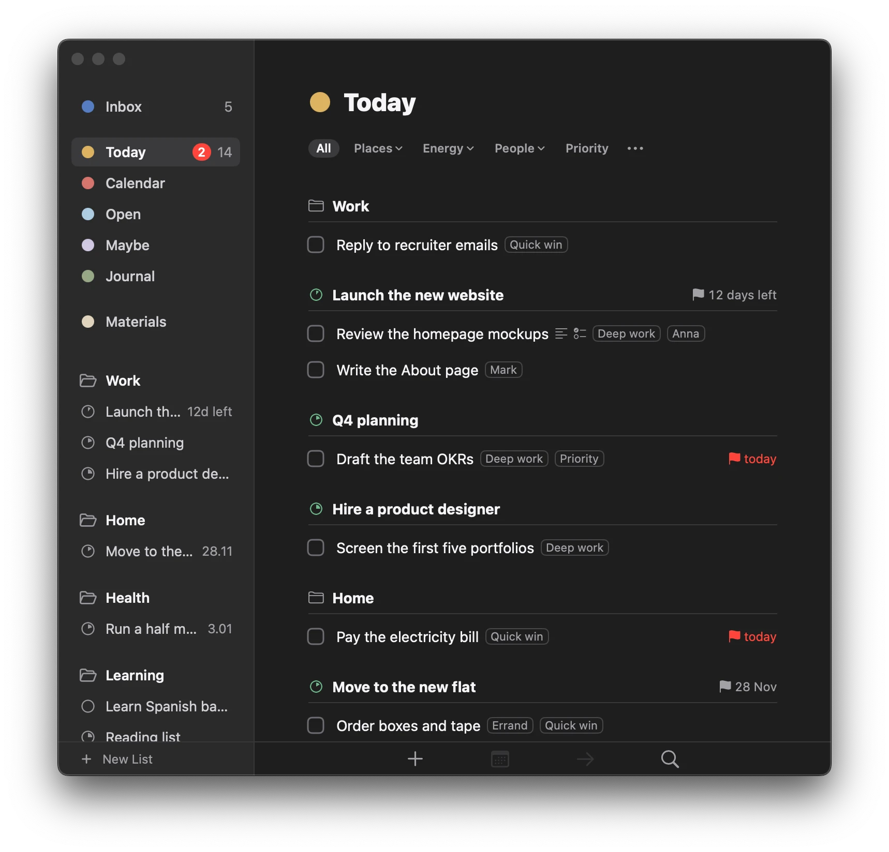
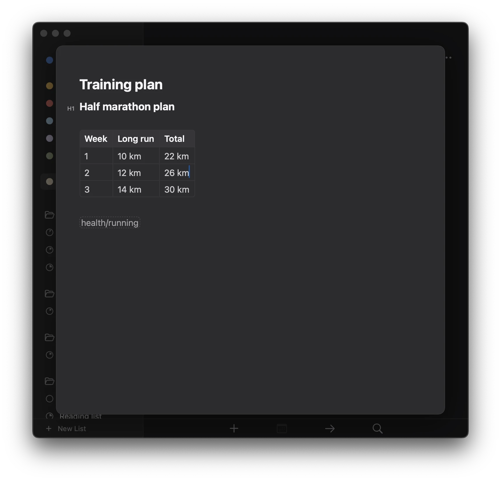

I am not a developer by any means. As a PM, I don’t even write SQL queries: Claude does it for me. The last time I wrote a script was about 3 years ago. I wanted an easy way to manage mic settings from the macOS menu bar (and I succeeded).

I’ve spent the last 3 weeks building a to-do and notes system for myself. It’s called Saglyth: systems and goals let you thrive. It is a mix of my favourite apps: Bear, Things, and Obsidian.

I removed Obsidian and Things from my machines after 3 days of development. And since then I am mostly gold plating the app with animations, design, and other tweaks.

It has Markdown, wiki links, locally stored files, Mermaid rendering, a fast interface, and many other features. It even works reasonably well with Claude. I manage Saglyth’s backlog using Claude in Saglyth.

Here are some screenshots.

My process is not the best. Here's how I work:

0. Idea. Describe the idea to Claude via the app or via Claude desktop.
1. Grooming. PM, BA, QA, and dev agents talk to each other to formulate spec. I re-read it, sometimes Claude asks questions. Here Claude also assigns the task to proper model.
2. Development and code review.
3. Then, building and using.
{: start="0"}

The process is not the best and must be enhanced. Being Claude subscriber, I don't really think of token usage, I have limits instead. Below what Claude calculated as usage and API price of the app.

| Model      | Tokens | ≈ $ at API prices[^prices] |
| ---------- | ------ | -------------------------- |
| Opus 5.5   | 5.40 B | 2,200–2,600                |
| Sonnet 5.5 | 515 M  | 180–210                    |
| Fable 5.1  | 66 M   | 75–90                      |
| Haiku 5.5  | 36 M   | ~1                         |
| Total      | 6.02 B | ≈ 2,400–2,900              |

What was the most emotional is not only how fast Claude is but how effective. I had a bug (the app was damn slow when I imported all my notes made since 2019) and Claude fixed it. A team of people would take weeks to do it.

So, to answer the question: building an app is super easy now. Period.

Now you can use an AI bro and solve all your problems (and probably your friends’). Go, legend!

[^prices]: All prices are calculated by Claude and may be wrong.
