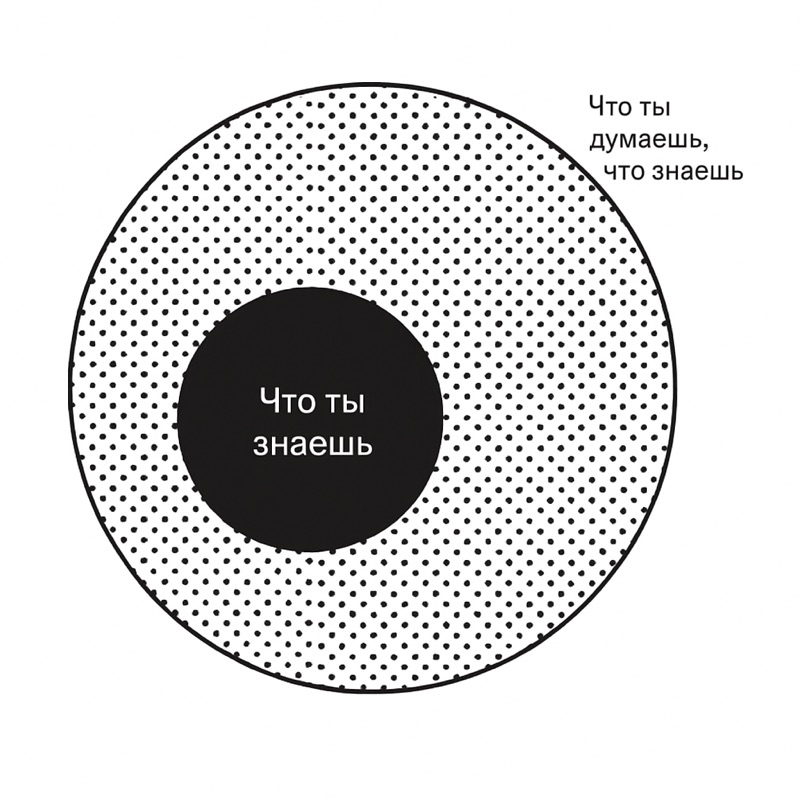

> Я знаю, что ничего не знаю. А другие не знают и этого.

## Понимать в чем мы сильны, а в чем мы думаем, что сильны

Очень важно знать не только кто мы и откуда, но и **понимать в чем мы сильны, а в чем мы думаем, что сильны**. Умение отделить одно от другого может уберечь нас от наступления множества неприятнх последствий. 

Том Уотсон, генеральный директор IBM говорил:

> Я не гений, но я силен в определенных сферах. В этих сферах я и останусь.

Эта идея дополняет круг компетенций тем, что **размер круга не имеет значение**, важно знать, что конкретно в него входит и оставаться в нём, потому что одно из главных правил соперничества заключается в том, что _гораздо легче победить там, где ты имеешь преимущество._ А использование преимущества требует глубокого понимания о том, что ты знаешь, а что — нет. 

Глубина в какой-то сфере — даже если вы чемпион мира — не даёт автоматом понимание другой сферы. Так, гроссмейстер может не уметь готовить глазунью, а стратегический консультант может зевнуть "детский мат". Помните, что глубокие знания в чем-то могут быть минусом в другом занятии или приводить к когнитивным искажениям.

Круг компетенций позволяет не только наслаждаться своими сильными сторонами, но и **знать, где мы пока слабы**. Мангер говорит:

> Лучше иметь IQ в 160 и думать, что оно 150, чем иметь 160 и думать, что 200. Такой человек может и "убить", ведь он не знает границы своих компетенций.

Как вывод ещё раз вспомним слова Мангера:

> Хотите добиться многого в жизни и бизнесе — определите периметр своего круга компетенции и начните действовать внутри него. Постепенно **работайте над расширением этого круга**. Но никогда **не лгите себе, где проходит его граница в данный момент**. И никогда не бойтесь сказать: "Я этого не знаю".

## Ссылки на идею

1. [Пост](/czerepaha/on-the-hook.html) о том, как желание быстрой наживы, заставило меня выпрыгнуть из круга.
